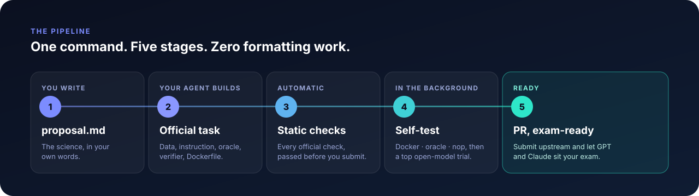
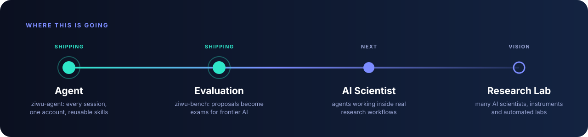

# ZIWU Bench · 子午智能

<!-- ZIWU introduction film -->

## From one idea to an AI evaluation task.

**Create and submit to ziwu-bench in one click.**

Turn a research idea, a real-world problem, or a plain-language proposal into a reproducible task that tests what AI can actually do. [**ziwu-agent**](https://github.com/ZIWU-AI/ziwu-agent) helps build the task, prepare its environment and scoring criteria, validate it, and submit a pull request to [**ZIWU-AI/ziwu-bench**](https://github.com/ZIWU-AI/ziwu-bench).

**Idea → Task → Validation → Pull request → Shared benchmark**

## Measure intelligence. Together.

Like the Prime Meridian, we aim to unite researchers and developers worldwide to precisely measure the boundaries of AGI.

**子午** (*ziwu*) evokes the meridian: a shared reference for measuring and connecting the world. Our vision extends from evaluating AI agents to autonomous research labs and embodied intelligence—building a common foundation for understanding what intelligent systems can do, where they fall short, and what comes next.

<p align="center">
  <a href="https://www.npmjs.com/package/@ziwu-ai/ziwu-agent"></a>
  <a href="https://ziwu.dev"></a>
  <a href="docs/TERMINAL-BENCH-SCIENCE.md"></a>
  <a href="LICENSE"></a>
</p>

---

## ⚡ The 60-second version

```bash
npm install -g @ziwu-ai/ziwu-agent     # one-time install
ziwu login                             # pair this computer with your ZIWU account
ziwu task new proposal.md              # proposal in, benchmark task PR out
```

That's the whole workflow. Behind that last line, ZIWU Bench:

1. **Reads your proposal** and works out what a fair, verifiable exam for it looks like.
2. **Builds the task in the official format**, with your own coding agent (Codex or Claude Code) working in your own folder: instruction, data, reference solution (oracle), verifier and container.
3. **Passes every static check** the benchmark enforces, locally, before anything is submitted.
4. **Self-tests it in the background**: Docker build, oracle and no-op validation, then an end-to-end trial by one of the strongest open models available.
5. **Opens the pull request** under your own GitHub account, ready for GPT and Claude to sit the exam.

Close the laptop halfway through? `ziwu task resume` picks up exactly where it stopped, on this computer or any other one signed in to the same account.

<br>

<p align="center">
  
</p>

<br>

## 🧪 Proof, not promises

A real run, start to finish, from a single proposal on **reaction-layer growth** in materials science:

<table>
  <tr>
    <td width="33%" valign="top">
      <h3>📦 The task</h3>
      <b>95 files</b> · <b>+23,918 lines</b><br><br>
      34 EDS spectra and 34 micrographs, an instruction, a reference solution, a separate verifier and a reproducible container. Generated from one Markdown file.
    </td>
    <td width="33%" valign="top">
      <h3>✅ The checks</h3>
      <b>Static checks:</b> all passed<br>
      <b>Similarity:</b> passed<br>
      <b>Docker build:</b> passed<br>
      <b>Oracle:</b> passed in 52 s<br>
      <b>No-op:</b> correctly fails
    </td>
    <td width="33%" valign="top">
      <h3>🤖 The self-test</h3>
      <b>Open-model trial:</b> pass, reward 1.0<br>
      <b>Agent time:</b> 78 minutes<br><br>
      Trial analysis, four for four: solvable, graded correctly, valid trial, meaningful evidence.
    </td>
  </tr>
</table>

No hand-editing of YAML. No reading a 40-criterion rubric. No guessing which check will fail in CI.

<br>

## 🔭 The part nobody expected

The most interesting result isn't the task. It's what happens to the researcher.

To become a benchmark, a research problem has to be **made precise**: what exactly is the input, what counts as a correct answer, how is it verified, and how hard is it really? Going through that, many researchers find that the reference solution they were sure of, their *oracle*, gets cracked by an AI that takes a **completely different route**.

Writing the exam turns into a fresh look at the research question itself.

<br>

## 🧰 Everything in one CLI

| Command | What it does |
|---|---|
| `ziwu task new proposal.md` | Proposal in, checked and self-tested task PR out |
| `ziwu task list` | Every task on your account, across all your computers, with live CI and trial status |
| `ziwu task status [PR \| name]` | Where a task stands: checks, trial result, which device it lives on |
| `ziwu task resume [PR \| name]` | Pick up an interrupted task, here or on another machine |
| `ziwu task check [PR \| name]` | Run the official static checks on demand |
| `ziwu skill list \| search \| add` | Install reusable skills distilled from real research sessions |
| `ziwu device sync \| watch \| status` | Sync your Claude Code and Codex sessions to your ZIWU workspace |
| `ziwu upgrade` | Update to the latest release in one step |

A task is identified the same way everywhere: by PR number (`76`), by name or a prefix of it (`reaction`), or by folder. With no argument, `ziwu` uses the task you're standing in.

**You'll need:** Node.js 22.13+, the [GitHub CLI](https://cli.github.com) signed in, and [Codex](https://github.com/openai/codex) or [Claude Code](https://claude.com/claude-code) set up. ZIWU never takes your keys: the task is built by *your* agent and submitted by *your* GitHub account.

<br>

## 🗺️ Bigger than a benchmark

<p align="center">
  
</p>

ZIWU Bench is the second step in a longer arc: from **Agent**, to **Evaluation**, to the **AI Scientist** working inside real research workflows, and finally to a **Research Lab**. That means many AI scientists working alongside instruments and automated laboratories, the research counterpart of a fully automated factory floor.

<br>

## 📚 What's in this repository

This repository is the task backend for ZIWU Bench. It carries the full [Terminal-Bench-Science](https://terminal-bench-science.ai) suite: **71 expert-curated tasks** across the life, physical, earth, mathematical and engineering sciences, together with the official task template, rubrics and quality checks that every ZIWU-generated task is held to.

<p align="center">
  
</p>

| Where | What |
|---|---|
| [`tasks/`](tasks/) | The benchmark tasks, organized as `tasks/<domain>/<field>/<task>` |
| [`rubrics/`](rubrics/) | Proposal, implementation and trial-analysis rubrics |
| [`ci_checks/`](ci_checks/) | The static checks a task must pass |
| [`CONTRIBUTING.md`](CONTRIBUTING.md) | The full task format, for anyone writing tasks by hand |
| [`docs/TERMINAL-BENCH-SCIENCE.md`](docs/TERMINAL-BENCH-SCIENCE.md) | The original Terminal-Bench-Science overview |

To keep this showcase light, task data files over 5 MB are not stored here; [`docs/LARGE-DATA.md`](docs/LARGE-DATA.md) lists them and shows how to restore them from upstream.

<br>

## 🤝 Credits

ZIWU Bench stands on [Terminal-Bench-Science](https://github.com/harbor-framework/terminal-bench-science) and the [Harbor](https://github.com/harbor-framework/harbor) framework, and on the domain experts who author and review its tasks. Benchmark content is distributed under the [Apache License 2.0](LICENSE); please cite Terminal-Bench-Science as described in [`CITATION.cff`](CITATION.cff).

<br>

<p align="center">
  <b>Built by <a href="https://ziwu.dev">ZIWU · 子午智能</a></b><br>
  <sub>Questions or collaborations: <a href="mailto:1750655781@qq.com">1750655781@qq.com</a></sub>
</p>
